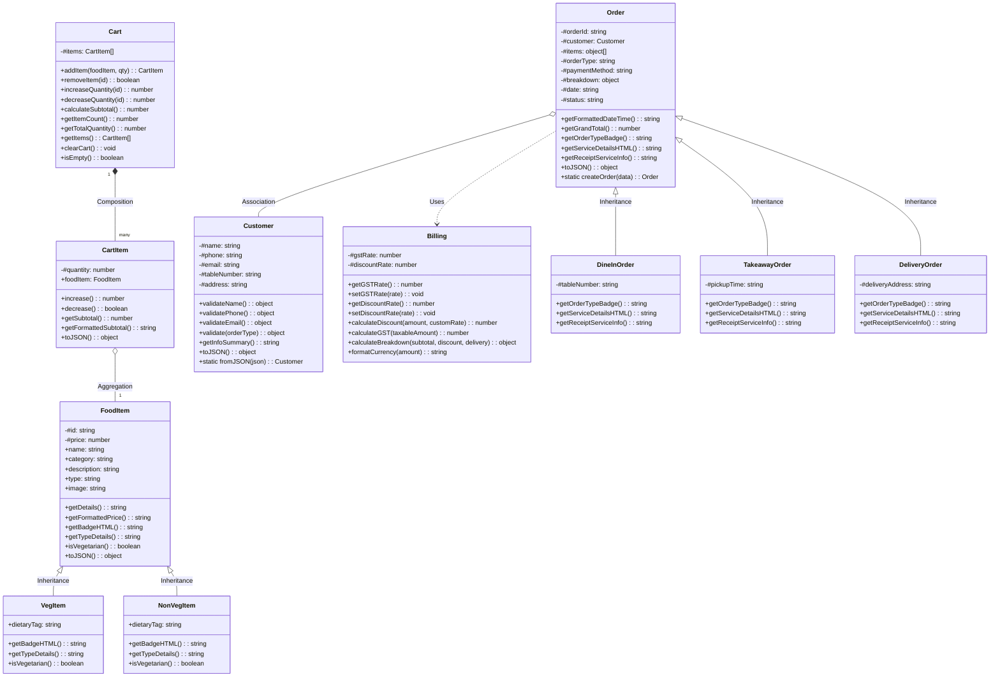

# 🍴 FoodEase – Food Billing System
> **Smart Restaurant Billing & Order Management**  
> Complete Object-Oriented Programming (OOP) Web Application in Pure JavaScript (ES6+), HTML5, and CSS3.

---

## 📋 Table of Contents
1. [Project Title & Overview](#-project-title--overview)
2. [Project Objectives](#-project-objectives)
3. [Technologies Used](#-technologies-used)
4. [Key Features](#-key-features)
5. [Core OOP Concepts Implemented](#-core-oop-concepts-implemented)
6. [Class Structure & Relationship Diagram](#-class-structure--relationship-diagram)
7. [Detailed Class Specifications](#-detailed-class-specifications)
8. [How Billing Calculations Work](#-how-billing-calculations-work)
9. [How to Run the Project](#-how-to-run-the-project)
10. [Folder & File Architecture](#-folder--file-architecture)
11. [Viva / Exam Q&A Reference](#-viva--exam-qa-reference)
12. [Future Improvements](#-future-improvements)

---

## 🍽 Project Title & Overview

**FoodEase** is a production-grade restaurant point-of-sale (POS) and food billing website designed specifically as a comprehensive **College OOP Project & Viva Showcase**.

Rather than relying on procedural JavaScript or complex black-box frontend frameworks (such as React, Angular, or Vue), FoodEase implements its entire core business logic—food catalogue, cart management, customer verification, taxation, and invoice generation—using **pure ES6 Object-Oriented Programming**. This architecture makes every OOP pillar visible, explainable, and demonstrable in real-time.

---

## 🎯 Project Objectives

- **Practical OOP Showcase:** Demonstrate Classes, Objects, Constructors, Encapsulation with private fields (`#`), Inheritance with `extends` & `super`, Polymorphism through method overriding, Abstraction, and the Factory Method Pattern.
- **Realistic Restaurant Operations:** Enable waitstaff and cashiers to browse categorised food items, search dynamically, manage live cart quantities, apply configurable discounts, calculate split GST (CGST + SGST), capture customer details for Dine In, Takeaway, or Delivery, and print thermal tax invoices.
- **Zero-Setup Portability:** Runs in any modern web browser without build tools, Node modules, or compilation steps.
- **Viva-Ready Design:** Features an integrated **OOP Architecture Guide** tab within the application so students can explain their design patterns live during presentations.

---

## 💻 Technologies Used

| Layer | Technologies |
|---|---|
| **Frontend UI** | HTML5 (Semantic), CSS3 (Custom Variables, Flexbox, Grid, `@media print`) |
| **Logic & OOP** | Vanilla JavaScript (ES6+ Classes, Private Fields, Static Methods) |
| **Icons & Typography** | Font Awesome 6, Google Fonts (*Plus Jakarta Sans* & *Space Mono*) |
| **Data Analytics** | Chart.js 4 (Dynamic Bar, Donut, and Pie Charts) |
| **Storage & Persistence** | Browser `localStorage` (JSON Serialization & Deserialization) |

---

## 🚀 Key Features

1. **Executive Dashboard:** Live metrics for Total Orders, Today's Sales, Total Customers, and Average Order Value, coupled with weekly revenue charts and category distribution donut graphs.
2. **Interactive Food Menu:** Filter by 6 distinct categories (*Burgers, Pizza, Indian, Chinese, Beverages, Desserts*) with real-time instant search.
3. **Dietary Indicators:** Authentic FSSAI-compliant green dot (*Pure Veg*) and red triangle (*Non-Veg*) badges generated polymorphically.
4. **Dynamic Cart Panel:** Real-time quantity increments/decrements, line-item subtotals, and trash removal.
5. **Flexible Order Types:** Supports **Dine In** (with Table Number), **Takeaway** (Counter pickup), and **Delivery** (Address capture and delivery charge calculation).
6. **Encapsulated Billing Engine:** Automatic computation of Subtotal, Net Discounts (0%, 5%, 10%, 15%, 20%, or custom %), and dual GST split (CGST 2.5% + SGST 2.5%).
7. **Customer Form Validation:** Enforces non-empty names, 10-digit phone patterns, valid email syntax, and conditional table/address rules.
8. **Thermal Invoice & Print Engine:** Authentically formatted tax receipt with barcode/stamp, order breakdown, and targeted `@media print` style sheet for thermal/A4 printers.
9. **Persistent Order History:** Browse past orders, view historical invoices, and delete records with automatic `localStorage` synchronization.
10. **Customer Directory:** Aggregates unique patrons with lifetime order frequency and total expenditure.
11. **Comprehensive Reports:** Analyzes payment method splits (Cash, UPI, Credit Card, Debit Card) and ranks the Top 5 Best-Selling dishes.
12. **Dark / Light Mode:** Instant theme toggle with CSS variable transitions and preference memory.
13. **Toast Notifications:** Non-blocking status toasts replacing intrusive browser alerts.

---

## 🧠 Core OOP Concepts Implemented

```
+-------------------------------------------------------------------------------+
|                             CORE OOP CONCEPTS                                 |
+-------------------------------------------------------------------------------+
| 1. Class & Object     | Blueprint and instance instantiation                  |
| 2. Constructor        | Property initialization & parameter binding           |
| 3. Encapsulation      | Private fields (#) with getters/setters & validation  |
| 4. Inheritance        | Subclasses acquiring parent features (extends, super) |
| 5. Polymorphism       | Method overriding producing subclass-specific behavior|
| 6. Abstraction        | Hiding calculation complexity behind public APIs      |
| 7. Factory Pattern    | Centralized polymorphic object creation               |
+-------------------------------------------------------------------------------+
```

### 1. Class & Object
- **Class:** A template defining data attributes and operational methods (e.g., `FoodItem`, `Cart`, `Customer`, `Order`, `Billing`).
- **Object:** Concrete runtime instances (e.g., `const burger = new VegItem("B01", "Burger", 120)`).

### 2. Constructor
Initializes instance state upon object creation.
```javascript
class FoodItem {
    constructor(id, name, category, price, description, type, image) {
        this.#id = id;
        this.name = name;
        this.category = category;
        this.price = price; // Uses encapsulated setter
        this.description = description;
        this.type = type;
        this.image = image;
    }
}
```

### 3. Encapsulation (Data Hiding)
Guards internal state from arbitrary external tampering using native private fields (`#`).
- In `Billing.js`: `#gstRate` and `#discountRate` cannot be changed directly without passing through boundary verification.
- In `Cart.js`: `#items` is a private array; external code must use `addItem()`, `removeItem()`, or `clearCart()`.
- In `Customer.js`: Customer details are protected by validation getters and setters.

### 4. Inheritance
Child classes inherit properties and behaviors from base classes, promoting code reusability:
- `VegItem` and `NonVegItem` extend `FoodItem`.
- `DineInOrder`, `TakeawayOrder`, and `DeliveryOrder` extend `Order`.

```javascript
class VegItem extends FoodItem {
    constructor(id, name, category, price, description, image) {
        super(id, name, category, price, description, 'veg', image);
        this.dietaryTag = "100% Veg";
    }
}
```

### 5. Polymorphism (Method Overriding)
Different classes respond to the identical method invocation in their own unique way:
- Calling `.getBadgeHTML()` on a `VegItem` returns a green square with an inner dot.
- Calling `.getBadgeHTML()` on a `NonVegItem` returns a red square with an inner triangle.
- Calling `.getReceiptServiceInfo()` on a `DineInOrder` outputs Table Service details; on a `DeliveryOrder`, it prints the customer delivery address and courier notes.

### 6. Abstraction
Hides complex algorithmic calculations and data manipulation behind clean, intuitive public methods:
- `billing.calculateBreakdown(subtotal, discountPercent)` abstracts taxable base resolution, CGST (2.5%), SGST (2.5%), and total summation into a clean JSON response.
- `customer.validate(orderType)` abstracts regex evaluation for phones and emails.

### 7. Factory Method Pattern
`Order.createOrder(data)` dynamically instantiates the appropriate subclass (`DineInOrder`, `TakeawayOrder`, or `DeliveryOrder`) based on the order type, decoupling the UI from subclass constructors.

---

## 📐 Class Structure & Relationship Diagram



---

## 🔬 Detailed Class Specifications

### 1. `FoodItem.js`
- **`FoodItem`**: Base class containing private `#id` and `#price`. Exposes getters and setters that enforce non-negative prices.
- **`VegItem`**: Subclass representing vegetarian dishes. Overrides `getBadgeHTML()` to display the FSSAI green symbol.
- **`NonVegItem`**: Subclass representing non-vegetarian dishes. Overrides `getBadgeHTML()` to display the red triangular symbol.

### 2. `Cart.js`
- **`CartItem`**: Encapsulates a reference to a `FoodItem` along with its line quantity. Computes `getSubtotal()` as `price * quantity`.
- **`Cart`**: Holds a private `#items` array. Manages additions, decrements, and total count. Returns defensive clones via `getItems()` to safeguard internal state.

### 3. `Customer.js`
- **`Customer`**: Holds private customer contact information. Encapsulates regex validation methods:
  - Phone validation: Checks 10-digit formats (`^[6-9]\d{9}$`).
  - Email validation: RFC-standard email pattern.
  - Contextual validation: Requires table numbers for Dine In, and addresses for Delivery.

### 4. `Billing.js`
- **`Billing`**: Encapsulates `#gstRate` (default 5%) and `#discountRate`.
- Computes complete financial breakdowns:
  $$\text{Discount Amount} = \text{Subtotal} \times \left(\frac{\text{Discount Rate}}{100}\right)$$
  $$\text{Taxable Amount} = \text{Subtotal} - \text{Discount Amount}$$
  $$\text{Total GST} = \text{Taxable Amount} \times \left(\frac{\text{GST Rate}}{100}\right)$$
  $$\text{CGST} = \frac{\text{Total GST}}{2}, \quad \text{SGST} = \frac{\text{Total GST}}{2}$$
  $$\text{Grand Total} = \text{Taxable Amount} + \text{Total GST} + \text{Delivery Fee}$$

### 5. `Order.js`
- **`Order`**: Root order class containing Order ID, timestamp, breakdown, items snapshot, and payment method.
- **`DineInOrder`**, **`TakeawayOrder`**, **`DeliveryOrder`**: Concrete polymorphic subclasses overriding receipt presentation.
- **`Order.createOrder(data)`**: Factory method providing clean polymorphism.

### 6. `app.js`
- **`FoodBillingApp`**: Central controller orchestrating DOM event binding, view transitions, Chart.js re-rendering, and toast notifications.

---

## 💰 How Billing Calculations Work

Example calculation for a typical meal:
1. **Items in Cart:**
   - 2 × Cheese Burger @ ₹150 = ₹300.00
   - 1 × Margherita Pizza @ ₹200 = ₹200.00
   - 2 × Cold Coffee @ ₹120 = ₹240.00
   - **Subtotal:** ₹740.00
2. **Discount Applied (10%):**
   - $\text{Discount Amount} = 740.00 \times 0.10 = \text{₹}74.00$
3. **Taxable Base:**
   - $\text{Taxable Amount} = 740.00 - 74.00 = \text{₹}666.00$
4. **GST Calculation (5% Total):**
   - $\text{Total GST} = 666.00 \times 0.05 = \text{₹}33.30$
   - $\text{CGST (2.5\%)} = \text{₹}16.65$
   - $\text{SGST (2.5\%)} = \text{₹}16.65$
5. **Grand Total:**
   - $\text{Grand Total} = 666.00 + 33.30 = \mathbf{₹746.55}$

---

## 🏃 How to Run the Project

Since the project uses pure web standards without dependencies or build pipelines:

### Method 1: Direct Browser Launch
1. Navigate to the project directory:
   ```
   food-billing-system/
   ```
2. Double-click **`index.html`** or right-click and select **Open with Chrome / Edge / Firefox**.

### Method 2: Local HTTP Server (Optional, Recommended for Fonts/Icons)
Run any lightweight static server:
```powershell
# Using Python
python -m http.server 8000

# Or using Node npx
npx serve .
```
Then open `http://localhost:8000` in your web browser.

---

## 📁 Folder & File Architecture

```text
food-billing-system/
│
├── index.html            # Main Single-Page Application interface
├── README.md             # Project documentation, OOP explanation & viva guide
│
├── css/
│   └── style.css         # Complete styling, CSS variables, dark mode & print media
│
├── js/
│   ├── FoodItem.js       # Base FoodItem, VegItem, and NonVegItem classes
│   ├── Cart.js           # Cart and CartItem classes (Encapsulation & Composition)
│   ├── Customer.js       # Customer class with regex form validation
│   ├── Billing.js        # Billing engine with encapsulated GST & discount rates
│   ├── Order.js          # Order hierarchy (DineIn, Takeaway, Delivery) & Factory
│   ├── data.js           # Initial 24+ menu items catalogue & seed demo orders
│   └── app.js            # FoodBillingApp coordinator & UI event bindings
│
└── images/               # Food imagery directory & fallbacks
```

---

## 🎓 Viva / Exam Q&A Reference

### Q1: What makes this project Object-Oriented instead of procedural?
**Answer:** In procedural code, data is stored in loose global variables and processed via separate utility functions. In FoodEase, data and behaviors are bound into formal **Classes** (`FoodItem`, `Cart`, `Customer`, `Order`, `Billing`). The cart maintains its own private `#items` state, items compute their own subtotals, and subclasses override methods polymorphically.

### Q2: Where and why are private fields (`#`) used?
**Answer:** Private fields are used in `Billing` (`#gstRate`), `Cart` (`#items`), and `Customer` (`#phone`). They enforce **Encapsulation** by preventing arbitrary outside code from corrupting tax rates or cart items without going through validated getter/setter methods.

### Q3: How is Polymorphism demonstrated in the project?
**Answer:** 
1. `VegItem` and `NonVegItem` both override `getBadgeHTML()`. The menu renderer simply calls `item.getBadgeHTML()` without checking `if (item.type === 'veg')`. The object itself determines its visual badge.
2. `DineInOrder`, `TakeawayOrder`, and `DeliveryOrder` override `getReceiptServiceInfo()`, printing table numbers, pickup notes, or delivery addresses accordingly.

### Q4: What design pattern is implemented in `Order.js`?
**Answer:** The **Factory Method Pattern** is implemented via `Order.createOrder(data)`. It acts as a virtual constructor that evaluates the order type and instantiates the correct subclass (`DineInOrder`, `TakeawayOrder`, or `DeliveryOrder`).

### Q5: How does data persistence work?
**Answer:** Objects implement a `.toJSON()` serialization method. When an order is generated, its state is serialized and stored in browser `localStorage`. Upon page reload, the static `Order.createOrder()` method deserializes the stored data back into fully functional object instances with all methods intact.

---

## 🌟 Future Improvements
- Kitchen Display System (KDS) live socket synchronization.
- Multi-terminal order synchronization using IndexedDB and Service Workers.
- Direct Bluetooth thermal ESC/POS printer driver integration.
- Barcode/QR scanner support via WebRTC camera streams.

---

*FoodEase – Smart Restaurant Billing & Order Management*  
*Developed with pure HTML5, CSS3, and Object-Oriented JavaScript.*
